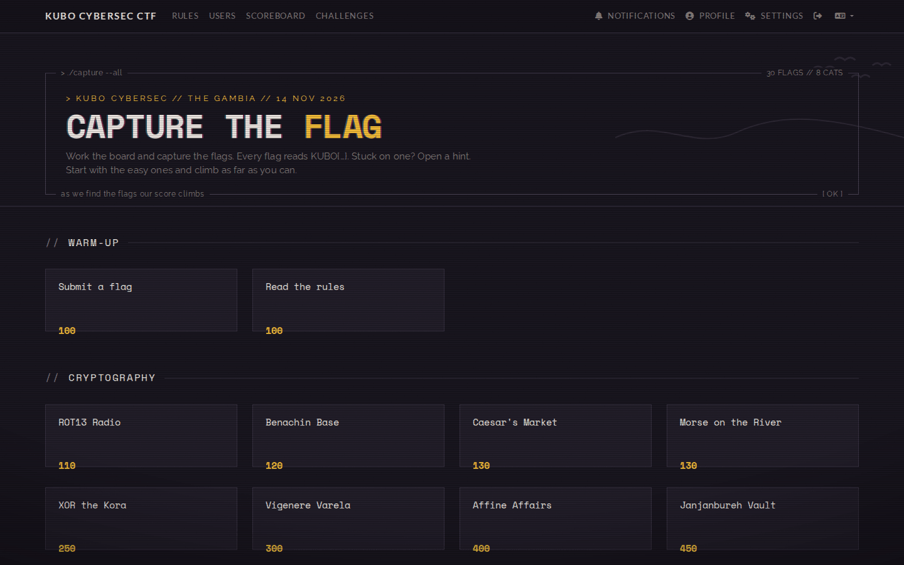
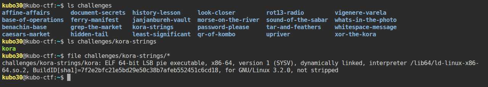
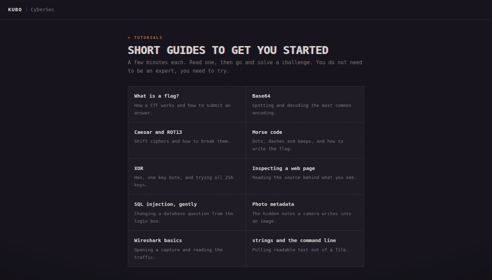

# offline-first-ctf

Everything for a Capture the Flag day in a room without internet: one server, a Wi-Fi
router, and the players' own laptops.

It was built for the first event of [KUBO CyberSec](https://kubo.global/communities/cybersec)
in The Gambia, where 18 people played 30 challenges for a day on one laptop and a home
router. This repository is the kit without that event's content, so you can run your own.



**Take it as a start.** This is what worked for us on one day, shared so you do not begin
from nothing. It is not a finished product, and you will want to change it for your room.
See [Where it stands](#where-it-stands) for what has and has not been tried, and
[Adapting it with an AI assistant](#adapting-it-with-an-ai-assistant) for the quickest way to make it yours.

**Offline-first** means: the game, the players' machines, the guides and the tools need
nothing from outside the room. One optional part, the AI helper, uses a connection when
the server has one, and switches itself off when it does not.

## What you get

One Docker Compose file starts all of it on one machine.

| Part | Port | What it is |
|---|---|---|
| The game | 8000 | [CTFd](https://github.com/CTFd/CTFd) with a custom theme: challenges, hints, scoreboard |
| A box per player | 2222 (SSH) | A small Linux container each, with the tools installed and the challenge files inside |
| Browser terminal | 8082 | The same box, for laptops where SSH is a hurdle |
| Guides | 8080 | Your tutorials, and a local copy of [CyberChef](https://github.com/gchq/CyberChef) at `/cyberchef/` |
| Web target | 8081 | The web application your web challenges attack |
| AI helper | 8083 | Optional. A tutor that gives hints, not flags, also as the `ai` command in every box |

Every player logs in to their own Linux box, with the challenge files already inside:



The guides are served from the same machine:



Around that:

- **`players.py`** makes the logins, one box per player, and a printable sheet of cards.
  One login works for the game, the box and the AI helper. Nobody registers and nobody
  types an email address.
- **`provision.py`** loads a challenge pack into CTFd: challenges, flags, hints, files, the
  Rules page.
- **`package-offline.sh`** builds and saves every image into one file, so the server can
  start on the day with no connection.
- **[RUNBOOK.md](RUNBOOK.md)** covers the network, the day itself and what to do when
  something breaks.

## What you need

- A server with Docker and 8 GB of memory for it. A laptop is fine. That is enough for
  about 60 players.
- A Wi-Fi router, with nothing in its internet port.
- A printer for the cards.
- Internet once, beforehand, to build and download.

## Try it in ten minutes

This runs the three-challenge example pack on your own machine.

```
cp .env.example .env
```

In `.env`, set the four passwords, and set `SERVER_ADDR` to your machine's address on
your network (not `127.0.0.1`: the player boxes reach the game through that address).

```
pip install requests
python3 players.py --beginner 2 --experienced 2
./package-offline.sh
docker compose up -d
python3 provision.py
python3 players.py --ctfd http://<SERVER_ADDR>:8000
```

Open `players/cards.html` for a login, then `http://<SERVER_ADDR>:8000`.

For a real event, follow [RUNBOOK.md](RUNBOOK.md).

## Your own challenges

The challenges are not part of the kit. They come from a **pack**: a folder that `PACK` in
`.env` points at.

```
my-pack/
  catalog.py       the challenges: name, category, points, flag, hints, files
  files/<slug>/    files per challenge: attached on the game site and placed in every box
  tutorials/       a static site, served on port 8080
  web-challenge/   a Docker build folder for a web target on port 8081
```

[`example-pack/`](example-pack/) is a small one that shows every part; its `catalog.py`
explains each field. Copy it and change it.

The 30 challenges of the KUBO CyberSec event are a pack too:
[offline-first-ctf-challenges](https://github.com/kubo-global/offline-first-ctf-challenges).

The flags live in `catalog.py` and are read only by `provision.py` on your own machine.
Only the pack's `files/` folder enters a container image. A `.c` file next to a program of
the same name is compiled inside the box image and then deleted, so players get the
program and not its source.

## Settings

All in `.env`; `.env.example` explains each one.

| Setting | What it does |
|---|---|
| `EVENT_NAME` | The name on the game site, the cards, the boxes and the AI helper |
| `EVENT_TAGLINE` | One line on the challenge board: who, where, when |
| `FLAG_PREFIX` | Flags look like `PREFIX{...}` |
| `LOGIN_PREFIX` | Logins are this word plus a number, such as `player01` |
| `PACK` | The folder of your challenge pack |
| `SERVER_ADDR` | The server's address on the room's network |
| `BIND_ADDR` | Which of the server's addresses the services listen on |
| `AI_API_KEY` and the other `AI_` settings | The AI helper: provider, model, limits, tutor or assistant |

The look is the KUBO theme in `themes/kubo/`. Set `CTFD_THEME=core` for CTFd's own.

## How the room is kept closed

- **The players' laptops** are on a Wi-Fi with no internet.
- **The game's database** sits on an internal network that nothing else reaches.
- **The player boxes** sit on an internal network with no route out. Their web tools go
  through a small proxy that reaches four addresses, all in the room: the game, the
  guides, the web target and the AI helper.
- **The web target** is the one deliberately weak service. It runs alone, holds no data,
  and the worst a player can do there is read a flag.
- **A box** has no root, and is capped in memory, processor and number of processes.

## The AI helper

It is the one part that needs internet, so it is the one place where the room opens, and
it opens as little as possible.

- **One container goes online.** A gateway holds the provider key and talks to the model.
  Players never see the key. The server gets its connection from a second network, such
  as a phone hotspot, that the room is not on.
- **A tutor by default.** It explains, suggests a next step and asks what you tried. It is
  told not to hand over a flag or a full solution, and it has never seen the flags.
- **Limits.** Questions per player per hour, a longest answer, and a token budget for the
  whole day. Every question is logged with the login that asked it.
- **It says what it is.** The page tells players their question goes to a service on the
  internet, and that the answer can be wrong.
- **Any OpenAI-compatible provider** works: set `AI_BASE_URL` and `AI_MODEL`. That
  includes a model you run yourself on the server, which would make the day fully
  offline. That setup has not been tried with this kit.
- **Without a key** the helper says it is switched off, and everything else works.

## What running it taught us

- **Check every page for things fetched from outside.** A web font from a font service is
  enough to make a page hang when there is no route out. Everything a player sees here
  ships with the kit.
- **Phones need a nudge.** A phone on a Wi-Fi without internet keeps using mobile data.
  Mobile data off, and "stay connected" when it warns.
- **Bring the tools into the room.** People solve challenges with online decoders. With
  CyberChef on the server, they still can.
- **Give everyone the same machine.** A box per player removes the first hour of
  installing things on a dozen different laptops.
- **Let everyone score early.** A warm-up challenge that cannot be failed means nobody
  sits at zero.
- **Accept the answer in more than one spelling** where the spelling is not the point.
  A challenge can set `any_case` and `also_accept`.
- **Rehearse on the real network, with the real server.** Most of what went wrong in
  preparation only showed up there.

## Adapting it with an AI assistant

We ran this on a Mac, with our router and our challenges. Yours will differ, and an AI
coding assistant can do most of the adapting. [AGENTS.md](AGENTS.md) is written for it: a
map of the kit, the ten things that must stay true so the room stays closed, the common
changes, and the checks that prove a change works.

Open this folder in your assistant and tell it your situation, for example:

- "Read AGENTS.md. My server is a Linux mini-PC with 8 GB and I expect 25 players. Walk me
  through the set-up and change what needs changing."
- "Read AGENTS.md. I do not want two rankings, I want teams of three."
- "Read AGENTS.md. Help me turn my five exercises into a challenge pack."

Have it run the checks at the end of that file before you trust a change, and rehearse in
the real room yourself.

## Where it stands

- **Ran for real once:** 18 players, one day, a Mac as the server, a home router and a
  phone hotspot for the AI helper.
- **Changed since that day:** the event's own details became settings, and the challenges
  moved into a separate pack. That version was tested end to end on a Linux machine, with
  the example pack and with the 30-challenge pack. It has not been through a second event.
- **Not tried in this version:** building on one kind of processor for another
  (`PLATFORM=...` in `package-offline.sh`), and a model running on the server itself.
- **Two rankings are built in.** Players are Beginner or Experienced. Other set-ups, such
  as teams, need changes in `players.py`.

If you run it, we would like to hear what you had to change.

## Licence and credits

Built by Shane Deconinck for [KUBO](https://kubo.global), a project of Afrodidact. The
first event was run with Alpha Omar Bah, who leads KUBO CyberSec.

Apache License 2.0: use it, change it, run your own events with it. See [LICENSE](LICENSE)
and [NOTICE](NOTICE). The KUBO name and logo and the artwork on the cards are not part of
that licence, so bring your own.

## Built on

[CTFd](https://github.com/CTFd/CTFd) (the theme in `themes/kubo/` is based on its core
theme), [sshpiper](https://github.com/tg123/sshpiper), [ttyd](https://github.com/tsl0922/ttyd),
[CyberChef](https://github.com/gchq/CyberChef), MariaDB, Redis and nginx. They are
downloaded by `package-offline.sh`, not copied into this repository, except the theme.
